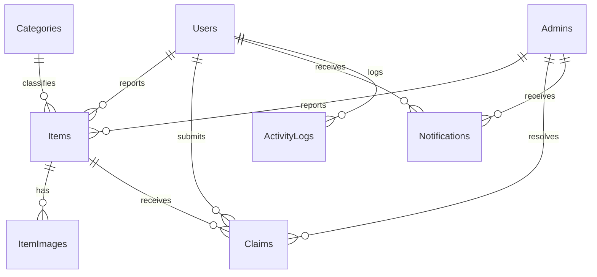

# CampusConnect -- Database & API Reference Manual

This document provides details of the CampusConnect database design, normalization analysis, entity relationships, and REST API specification.

---

## 1. Entity-Relationship (ER) Diagram

---

## 2. Relational Schema

- **Users** (**user_id** (PK), username, email, password_hash, roll_number, phone_number, created_at)
- **Admins** (**admin_id** (PK), username, email, password_hash, created_at)
- **Categories** (**category_id** (PK), name, description, created_at)
- **Items** (**item_id** (PK), name, description, *category_id* (FK), type, location, date_reported, status, *user_id* (FK, Null), *admin_id* (FK, Null), created_at)
- **ItemImages** (**image_id** (PK), *item_id* (FK), image_path, uploaded_at)
- **Claims** (**claim_id** (PK), *item_id* (FK), *user_id* (FK), description, status, *admin_id* (FK, Null), admin_remarks, claimed_at, updated_at)
- **Notifications** (**notification_id** (PK), *user_id* (FK, Null), *admin_id* (FK, Null), title, message, is_read, created_at)
- **ActivityLogs** (**log_id** (PK), user_type, user_id, action, details, created_at)

---

## 3. Database Normalization (Up to 3NF)

To demonstrate rigorous DBMS design, all tables conform to **Third Normal Form (3NF)**:

### First Normal Form (1NF)
- All columns contain only **atomic, single-valued** attributes (e.g. `phone_number` and `roll_number` contain clean values, not comma-separated lists).
- Every table has a clearly defined primary key (`user_id`, `item_id`, `claim_id`, etc.) to uniquely identify records.

### Second Normal Form (2NF)
- The database is in 1NF.
- There are no **partial dependencies**. All non-prime attributes are fully functionally dependent on the entire primary key.
- Since all primary keys are single columns (`user_id`, `item_id`, etc.), it is impossible to have partial dependencies (which can only occur on composite primary keys).

### Third Normal Form (3NF)
- The database is in 2NF.
- There are no **transitive dependencies**. Non-prime attributes depend only on the primary key, and not on other non-prime attributes.
- E.g., in the `Items` table, we store only `category_id` (FK to Categories). We do not store `category_name` or `category_description` in `Items`, as that would create a transitive dependency (`item_id` -> `category_id` -> `category_name`). Instead, names and descriptions are fetched via JOIN.
- In `Claims`, we store only `user_id` and `item_id`. User details (username, email) are kept exclusively in `Users`, avoiding transitive redundancy.

---

## 4. Stored Procedures, Views, & Triggers

### Views
1. **`vw_item_details`**: Merges items with their category, reporter credentials (either student or admin), and includes their primary uploaded image path.
2. **`vw_claim_details`**: Aggregates claim items, claimants (student username and email), and reviewing admin comments.

### Stored Procedures
1. **`sp_submit_claim`**: Transactional claim submissions. Ensures the item exists and is active, and verifies the student hasn't already submitted a claim.
2. **`sp_process_claim`**: Evaluates claim validations inside a TRANSACTION. If approved, marks the item as `'claimed'`, and rejects all other pending claims for that item automatically.
3. **`sp_get_admin_stats`**: Summarizes category distribution metrics (using `GROUP BY` and `HAVING`) and returns claims resolution breakdowns.

### Triggers
1. **`after_claim_insert`**: Logs a `CLAIM_SUBMITTED` action automatically to audit logs.
2. **`after_claim_update`**: Detects claim updates. Generates an instant recipient notification message to the claimant with approval/rejection remarks.
3. **`after_item_insert`**: Audits newly reported items to logs.

---

## 5. API Documentation

### Authentication API
- `POST /api/auth/register` : Student registration.
  - Body: `{ username, email, password, roll_number, phone_number }`
- `POST /api/auth/login` : Student login.
  - Body: `{ identifier, password }` (identifier can be username or email)
- `POST /api/auth/admin/login` : Admin secure login.
  - Body: `{ identifier, password }`
- `GET /api/auth/profile` : Fetch active profile data.
  - Header: `Authorization: Bearer <JWT_Token>`

### Items API
- `GET /api/items` : Query reported items list. Supports filters: `name`, `category_id`, `location`, `status`, `type`.
- `GET /api/items/:id` : Fetch detailed item information and all uploaded images.
- `POST /api/items` : Create a lost/found report. Accepts Multi-part Form Data (`image` file, `name`, `description`, `category_id`, `type`, `location`, `date_reported`).
- `PUT /api/items/:id` : Update details of a report (accessible by reporter or admins).
- `DELETE /api/items/:id` : Remove report and disk files.

### Claims API
- `POST /api/claims` : Submit a claim (students only). Uses stored procedure.
  - Body: `{ item_id, description }`
- `GET /api/claims` : List claims. Returns claimant's own items if student; returns all items if admin.
- `PUT /api/claims/:id/process` : Resolve claim (admins only). Uses transactional stored procedure.
  - Body: `{ status: 'approved' | 'rejected', remarks }`

### Categories API
- `GET /api/categories` : List all item categories.
- `POST /api/categories` : Add new category (admin only).
- `PUT /api/categories/:id` : Update category details (admin only).
- `DELETE /api/categories/:id` : Remove category (admin only).

### Notifications API
- `GET /api/notifications` : Fetch unread logs.
- `PUT /api/notifications/:id/read` : Mark specific notification read.
- `PUT /api/notifications/read-all` : Mark all user notifications read.
