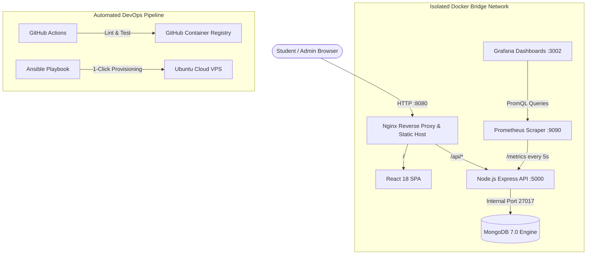

# 🎓 Lost & Found -- Enterprise Campus Platform

A production-ready, full-stack Lost & Found Management System designed for college campuses, engineered with the **MERN Stack** and containerized with an enterprise **DevOps & Observability Pipeline** (Docker, Nginx, Prometheus, Grafana, Ansible, and GitHub Actions CI/CD).

Students can report lost or found belongings with image attachments, filter active items, submit ownership claims with proof, and receive moderation updates. Campus administrators can moderate posts, resolve claims via cascading state machines, and track system analytics through audit logs and live telemetry dashboards.

---

## 🏗️ System Architecture



---

## 🛠️ Technology & DevOps Stack

* **Frontend**: React 18 (Vite), React Router v6, Axios, Vanilla CSS3 (Single Page Application).
* **Backend**: Node.js, Express.js REST API, JWT Authentication, bcryptjs password hashing, Multer file upload handling.
* **Database**: MongoDB 7.0, Mongoose ODM with relational references, virtuals, and cascading state transitions.
* **Containerization**: Docker multi-stage builds (`node:20-alpine` build stage $\rightarrow$ `nginx:alpine` production stage).
* **Orchestration**: Docker Compose managing 5 microservices (`client`, `server`, `mongo`, `prometheus`, `grafana`).
* **Observability & APM**: `prom-client`, Prometheus time-series metrics scraper, and Grafana telemetry dashboards.
* **CI/CD Automation**: GitHub Actions pipeline for automated syntax testing and container image builds.
* **Infrastructure as Code (IaC)**: Ansible Playbooks for automated Ubuntu cloud server provisioning and UFW firewall hardening.

---

## 📂 Project Structure

```text
Lost and Found/
 ├── .github/
 │    └── workflows/
 │         └── ci-cd.yml          # GitHub Actions automated test & Docker build pipeline
 ├── ansible/
 │    └── setup-server.yml        # Ansible playbook for 1-click cloud VPS provisioning
 ├── client/
 │    ├── src/                    # React components, pages, services, and CSS
 │    ├── nginx.conf              # Nginx reverse proxy, client routing & upload size config
 │    ├── Dockerfile              # Multi-stage Docker build (Node build -> Nginx runtime)
 │    └── .dockerignore
 ├── server/
 │    ├── config/db.js            # MongoDB connection logic
 │    ├── controllers/            # Controller business logic (Auth, Items, Claims, Admin)
 │    ├── middleware/             # JWT authentication & role-based access guards
 │    ├── models/                 # Mongoose schemas (User, Item, Claim, Category, etc.)
 │    ├── routes/                 # Express REST API routes
 │    ├── reset_db.js             # Database reset & default admin seeder
 │    ├── Dockerfile              # Lightweight Alpine Node.js production image
 │    └── .dockerignore
 ├── docker-compose.yml           # Multi-container orchestration (App + DB + Prometheus + Grafana)
 ├── prometheus.yml               # Metrics scraping configuration
 └── README.md
```

---

## 🚀 Quick Start with Docker (Recommended)

Run the entire full-stack application, database, and monitoring stack with a single command:

```bash
# 1. Clone the repository
git clone https://github.com/RavirajP07/Lost-and-Found.git
cd Lost-and-Found

# 2. Build and launch all 5 containers in detached mode
docker compose up --build -d
```

### Accessing the Running Services:
* 🌐 **Web Application**: [`http://localhost:8080`](http://localhost:8080)
* 📊 **Grafana Monitoring Dashboard**: [`http://localhost:3002`](http://localhost:3002) *(User: `admin`, Pass: `admin`)*
* 🔍 **Prometheus Raw Metrics**: [`http://localhost:9090`](http://localhost:9090)

---

## 🔑 Demo Credentials

To test the application immediately without registering:

* **Admin Account**: `admin@lostandfound.com`
* **Password**: `admin123`

To test the student flow, simply click **Register** on the login screen to create a new student account.

---

## 📊 Observability & Metrics Setup

The backend exposes real-time operational telemetry at `/metrics`. 

1. Open Grafana at `http://localhost:3002`.
2. Add Prometheus as the data source with URL `http://prometheus:9090`.
3. Query metrics such as:
   * `http_requests_total` -- Total requests segregated by HTTP method, route, and status code.
   * `process_cpu_user_seconds_total` -- CPU core consumption.
   * `nodejs_heap_size_used_bytes` -- Memory utilization in bytes.

---

## 📜 License
Developed by **Raviraj P** -- College of Engineering, Guindy, Anna University.
